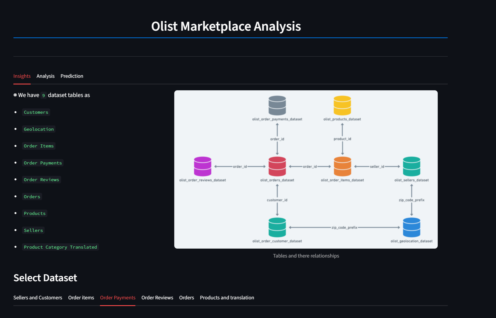
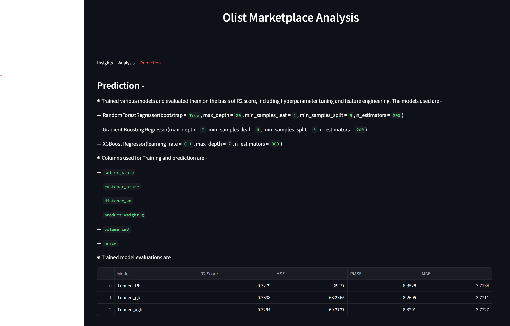
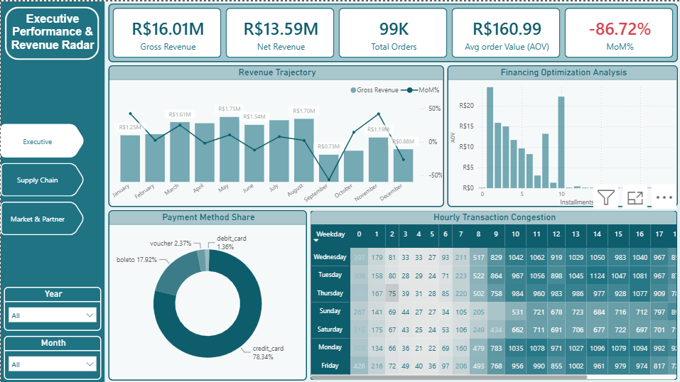
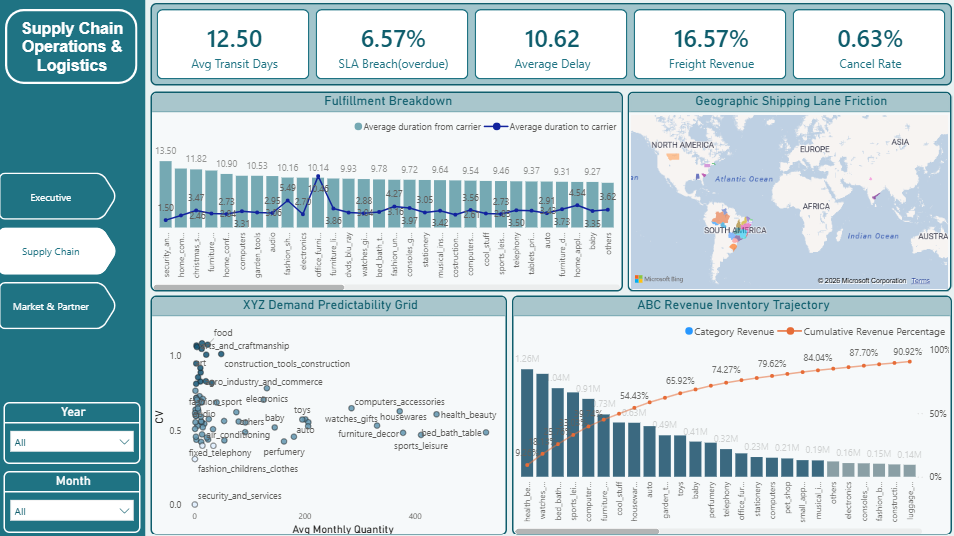
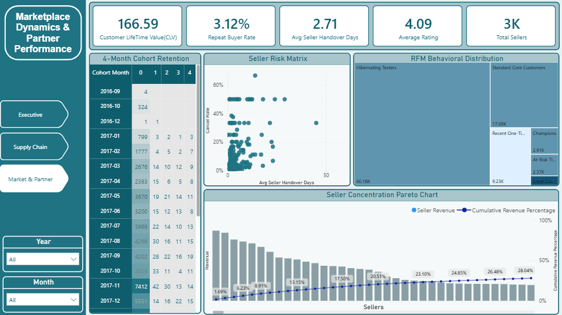

# Olist E-Commerce End-to-End Analytics & Machine Learning Pipeline

An end-to-end data analytics and machine learning solution for the **Olist Brazilian E-Commerce Dataset**. This project encompasses relational database architecture, exploratory data analysis (EDA), interactive Power BI dashboards, advanced statistical segmentation (RFM, ABC/XYZ), predictive machine learning for freight price estimation, and a full-featured **Streamlit web application**.

---

## Dashboard & Web App Previews

### 1. Streamlit Interactive Web Application
The Streamlit app serves as an interactive presentation suite, offering deep EDA, advanced marketplace analytics, and live ML inference.

| **Analysis & Advanced Analytics** | **Shipping Cost Prediction** |
| :---: | :---: |
|  |  |

---

### 2. Power BI Enterprise Reporting Suite
A three-page executive dashboard built in Power BI to monitor financial health, supply chain efficiency, and seller risk.

| **Page 1: Executive Performance** | **Page 2: Supply Chain Operations** | **Page 3: Marketplace Dynamics** |
| :---: | :---: | :---: |
|  |  |  |

---

##  Repository Directory Map

```text
├── Data_Overview_and_MetaData/         # Dataset documentation, metadata word files & ERD relationship diagrams
├── dataset/                            # Raw CSV dataset files across all marketplace entities
├── Insights/                           # Exploratory Data Analysis (EDA) notebooks & generated visual assets
│   ├── plotly/                         # Interactive Plotly JSON/HTML exports
│   ├── plots_Images/                   # Saved static images used inside the Streamlit app & README previews
│   ├── Analysis.ipynb                  # Master analysis notebook (RFM, ABC/XYZ, Market Basket)
│   ├── Cust_insights.ipynb             # Customer entity exploration
│   ├── Order_items_insight.ipynb       # Item-level transaction insights
│   ├── order_payment_insights.ipynb    # Payment method & financing breakdown
│   ├── order_reviews.ipynb             # Customer sentiment & rating analysis
│   ├── Orders_insight.ipynb            # Order lifecycle & delivery performance
│   ├── Product_translation.ipynb       # Category translation mapping
│   ├── Products_insights.ipynb         # Product category distribution
│   └── Sellers_insights.ipynb          # Seller performance metrics
├── ml_model/                           # Machine Learning engineering pipeline
│   ├── saved_pkl_models/               # Exported trained model pickles (.pkl)
│   ├── Final_model_training_feature_engineering_&_tuning.ipynb # Production model notebook
│   ├── model_training.ipynb            # Baseline ML model experiments
│   └── tunned_model_evaluations.csv    # Hyperparameter performance log
├── PowerBi_Dashboard/                  # Enterprise Power BI (.pbix) reporting suite
├── sql/                                # Analytical SQL query scripts & schema definitions
├── app.py                              # Streamlit application entry point
└── requirements.txt                    # Python environment dependencies
```

## Key Features & Web Application Structure
The Streamlit App (app.py) serves as the interactive presentation platform, structured into three primary modules:

### 1. Data Overview & Metadata
Data Dictionary & Schema: Interactive table-level descriptions and entity-relationship mapping.

Individual Entity Insights: Deep-dive exploratory charts for Customers, Sellers, Orders, Payments, and Reviews rendered directly from saved visualization assets.

### 2. Advanced Analytics Engine
RFM Customer Segmentation: Treemap and matrix distribution classifying buyers into Champions, At-Risk, Loyal, and Hibernating tiers.

ABC/XYZ Inventory Matrix: Pareto revenue concentration combined with demand predictability coefficient of variation (CV).

Market Basket Affinity: Analysis of co-purchased category combinations across multi-item orders.

Geographic & Logistics Friction: Inter-state shipping bottlenecks, delivery SLA breach rates, and transit delay impact on review scores.

### 3. Shipping Freight Price Predictor
ML Inference Interface: Live freight cost estimator powered by tuned Machine Learning regression models, taking into account package weight, dimensions, product price and geolocation distance. 

## Power BI Dashboard Highlights
The repository includes a multi-page .pbix report inside the PowerBi_Dashboard/ folder:

Executive Performance & Revenue Radar: Tracks GMV, Net Revenue, AOV, and Hourly Transaction Congestion.

Supply Chain Operations & Logistics: Evaluates Carrier SLA breaches, Freight Revenue, and ABC Revenue Inventory Trajectory.

Marketplace Dynamics & Partner Performance: Monitors Seller Risk Matrix (Latency vs. Cancellations) and Cohort Retention.

## Tech Stack & Libraries
Frontend Dashboard: Streamlit
Data Processing: Pandas, NumPy

Visualization: Plotly Express & Graph Objects, Matplotlib, Seaborn

Machine Learning: Scikit-Learn, XGBoost, GradientBosst, Joblib

Business Intelligence & SQL: Power BI Desktop, MySQL

## Local Installation & Deployment Guide
Follow these steps to run the Streamlit app locally:

1. Clone the Repository
```Bash
git clone https://github.com/ankit-sheoran-523/Olist_Analysis.git
cd Olist_Analysis
```
2. Create & Activate a Virtual Environment
```Bash
# Windows
python -m venv venv
venv\Scripts\activate
```
# macOS / Linux
```
python3 -m venv venv
source venv/bin/activate
```
3. Install Dependencies
```Bash
pip install -r requirements.txt
```
4. Run the Streamlit Application
```Bash
streamlit run app.py
```


# Large Files
Due to GitHub size limits, large assets are stored externally (powerBI and trained model pipelines):
- [Download Complete Files](https://drive.google.com/drive/folders/1XIQMDaFeG6u9NxYCQbxb8PQT9HrRnCPf)